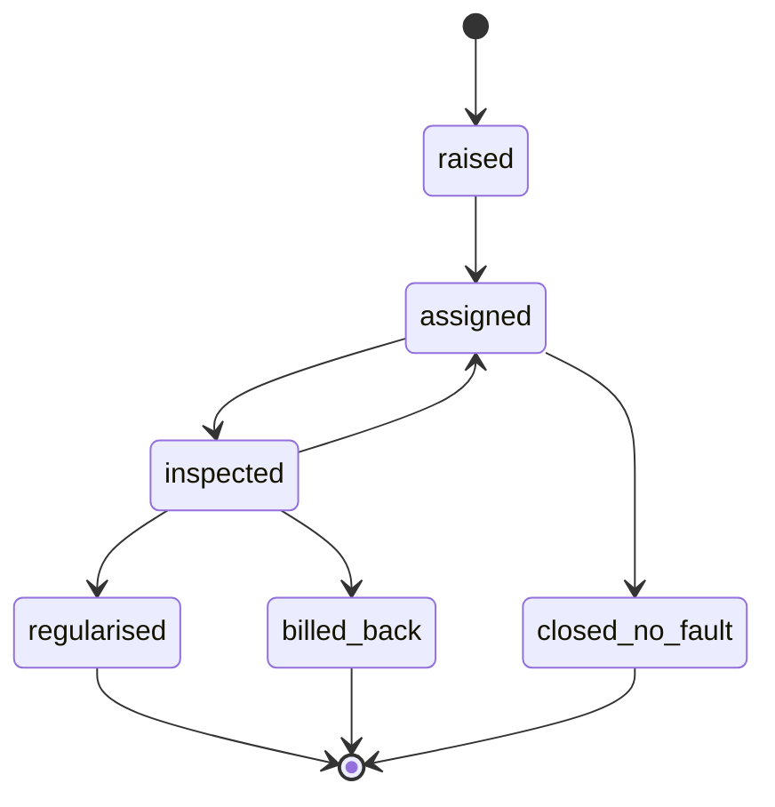
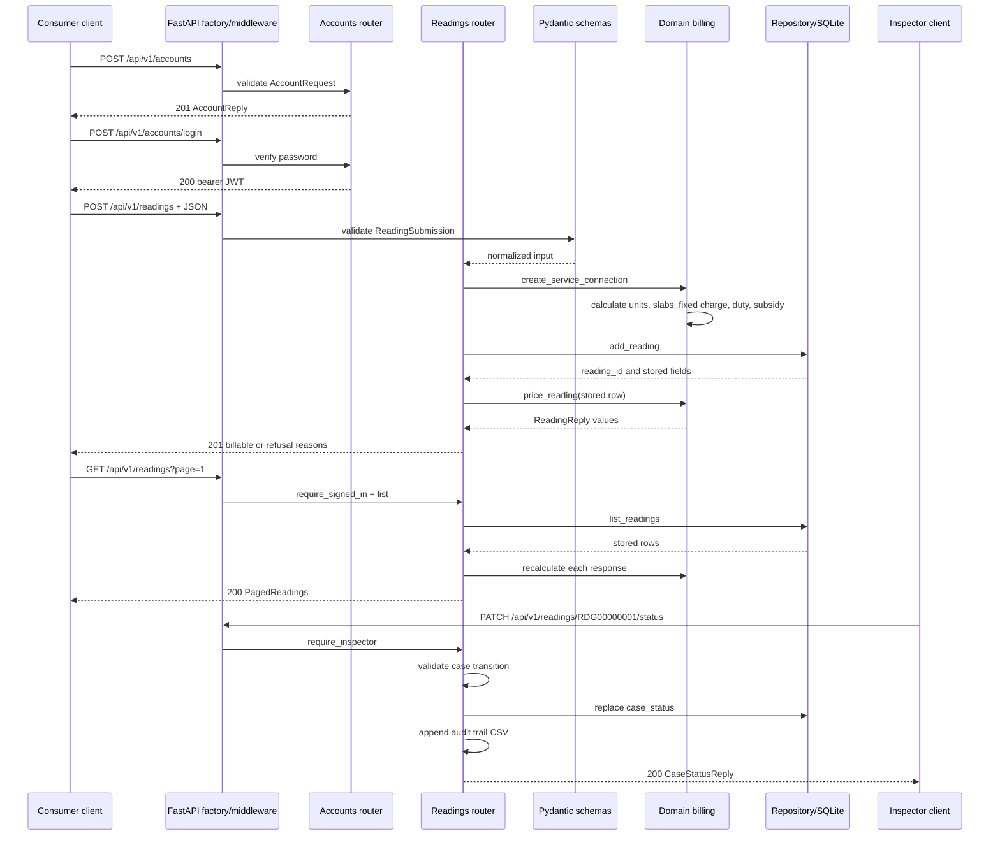

# FastAPI Reference

The service is created by `metermind.api.application_factory.build_application` with the prefix `/api/v1`. OpenAPI/Swagger is provided by FastAPI at `/docs` when the application is running. Middleware applies to every route: request logging, fixed-window rate limiting by client IP, and CORS.

## Access model

`POST /accounts` and `POST /accounts/login` are public. `require_signed_in` accepts any valid non-expired bearer JWT. `require_inspector` accepts only a valid JWT whose `role` equals the configured inspector role. The code has no `instructor` role; “instructor” should be read as “inspector” unless the role model is changed.

| Method | Path | Access | Purpose |
|---|---|---|---|
| GET | `/api/v1/health` | Public | Service liveness |
| POST | `/api/v1/accounts` | Public | Create an in-memory account |
| POST | `/api/v1/accounts/login` | Public | Verify password and issue JWT |
| POST | `/api/v1/readings` | Currently public | Validate, store, and price a reading |
| GET | `/api/v1/readings/{reading_identifier}` | Currently public | Load and price one reading |
| PUT | `/api/v1/readings/{reading_identifier}` | Currently public | Replace and reprice a reading |
| DELETE | `/api/v1/readings/{reading_identifier}` | Currently public | Delete a reading |
| GET | `/api/v1/readings` | Signed in | Filter and page readings |
| PATCH | `/api/v1/readings/{reading_identifier}/status` | Inspector | Move a case and audit the move |
| POST | `/api/v1/screening` | Signed in | Run the champion exception model |
| POST | `/api/v1/assistant/questions` | Signed in | Ask the stateful assistant |
| POST | `/api/v1/assistant/threads/{thread_id}/release` | Inspector | Release a human-held assistant run |

The “currently public” reading endpoints are an implementation fact, not a recommendation: the route functions do not declare an authentication dependency.

## Contracts

### Health

`GET /api/v1/health` returns:

```json
{"service": "metermind", "status": "up"}
```

### Account creation

`POST /api/v1/accounts` accepts `AccountRequest`:

```json
{
  "account_number": "ACC10000123",
  "email_address": "consumer@example.com",
  "password": "correct horse battery staple",
  "role": "consumer"
}
```

The account number and email are normalized. The password is hashed. Accounts live in the module-level `accounts` dictionary. A duplicate account returns `409`.

### Login

`POST /api/v1/accounts/login` accepts `account_number` and `password`. A valid request returns:

```json
{"access_token": "<jwt>", "token_type": "bearer", "role": "consumer"}
```

Invalid credentials return `401`. The JWT contains `sub`, `role`, and `exp` and is signed with the configured secret.

### Submit a reading

`POST /api/v1/readings` accepts `ReadingSubmission`:

```json
{
  "account_number": "ACC10000123",
  "meter_serial": "MTR-AB-123456",
  "consumer_category": "domestic",
  "billing_period": "2026-06",
  "sanctioned_load_kw": 3,
  "cycle_days": 30,
  "previous_reading": 14208,
  "current_reading": 14675,
  "read_type": "actual",
  "read_date": "2026-06-30"
}
```

Pydantic validates the shape and normalizes selected fields. The router then calls `create_service_connection`, rejects an unknown tariff category with `422`, stores the raw reading, recalculates the bill, and returns `ReadingReply` with `201`:

```json
{
  "reading_id": "RDG00000001",
  "account_number": "ACC10000123",
  "consumer_category": "domestic",
  "units_consumed": 467.0,
  "energy_charge_inr": 2575.70,
  "fixed_charge_inr": 150.0,
  "net_bill_inr": 2854.48,
  "is_billable": true,
  "refusal_reasons": []
}
```

The exact monetary values depend on the configured tariff constants. Storage failures are translated only where the route explicitly catches them; validation failures are FastAPI `422` responses.

### Read, replace, delete, and list readings

- `GET /api/v1/readings/{reading_identifier}` loads a reading, calculates a fresh `ReadingReply`, and returns `404` when absent.
- `PUT /api/v1/readings/{reading_identifier}` accepts the same submission body, validates the category, replaces the stored row, and returns the fresh price. Missing IDs return `404`.
- `DELETE /api/v1/readings/{reading_identifier}` deletes the row and returns `204`; missing IDs return `404`.
- `GET /api/v1/readings` requires a bearer token. Optional query parameters are `consumer_category`, `read_type`, `page` (default `1`, minimum `1`), and `page_size` (default `20`, range `1..200`). It returns `PagedReadings` with `readings`, `page`, `page_size`, and `total`.

### Case status

`PATCH /api/v1/readings/{reading_identifier}/status` requires an inspector token and accepts:

```json
{"wanted_status": "assigned", "noted_by": "inspector-17"}
```

The status ladder is:



The router reads the current status, validates the requested move, replaces the stored status, appends an audit CSV row, and returns `CaseStatusReply`. Missing readings return `404`; invalid transitions return `409`; missing/incorrect credentials return `401` or `403`.

### Exception screening

`POST /api/v1/screening` requires a signed-in token and accepts `ScreeningRequest`, which extends `ReadingSubmission` with model features such as consumption history, arrears, payment defaults, seal result, meter details, division, installation date, and cycle end date.

The route loads the champion model and operating rule once, widens the features, applies the champion decision rule, obtains the selected class probability, and maps the class to an investigation queue. If model artifacts are missing it returns `503`.

Response:

```json
{
  "account_number": "ACC10000123",
  "billing_period": "2026-06",
  "exception_class": "meter_fault",
  "confidence": 0.8421,
  "goes_to": "meter_fault_queue"
}
```

### Assistant question

`POST /api/v1/assistant/questions` requires any signed-in token and accepts:

```json
{
  "question": "Why was my bill this amount?",
  "consumer_category": "domestic",
  "billing_period": "2026-06",
  "thread_id": "thread-1001"
}
```

The workflow triages the question, plans calls to reading/billing/exception/tariff tools, runs the tools, drafts an answer, critiques it, passes through an approval gate, and returns a thread outcome. The graph is checkpointed in SQLite so a held run can later continue.

`POST /api/v1/assistant/threads/{thread_id}/release` requires an inspector token. It resumes a checkpointed run. An unknown thread returns `404`.

## Complete example: consumer reading through inspector action



## Error and dependency behavior

- `401`: no bearer token, invalid token, expired token, or bad login.
- `403`: valid token but not the inspector role.
- `404`: missing reading or assistant thread.
- `409`: duplicate account or invalid case transition.
- `422`: Pydantic validation or unsupported consumer category.
- `429`: fixed-window rate limit exceeded.
- `503`: screening model or operating rule is unavailable.
