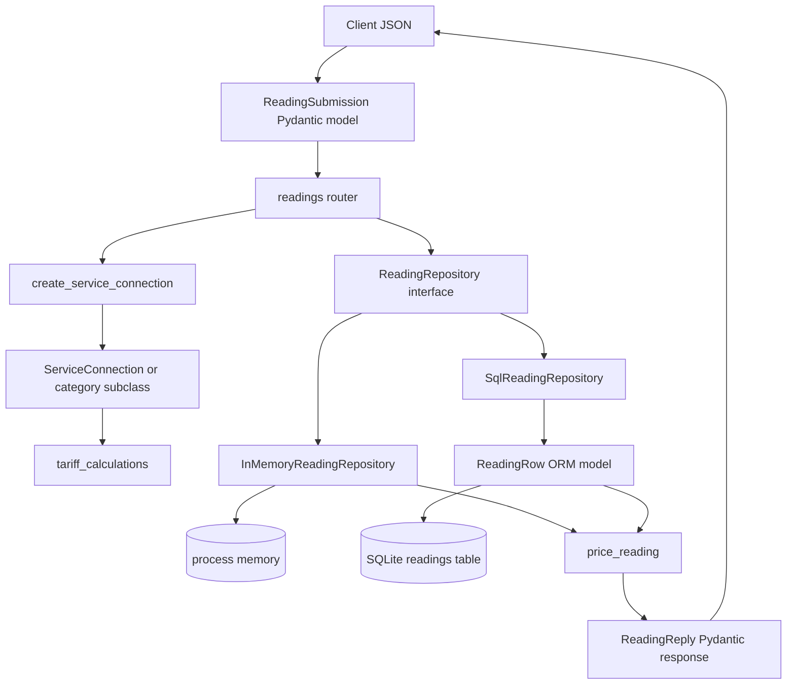
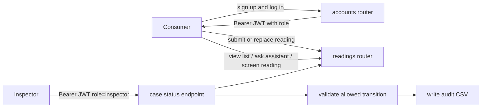

# MeterMind

MeterMind is a Python electricity-reading and billing platform. It combines a FastAPI service, tariff calculation, reading storage, exception screening, complaint intelligence, an assistant, and tariff-document retrieval.

## Repository map

- `metermind/api/`: FastAPI application, Pydantic contracts, authentication, repositories, ORM mapping, middleware, and routers.
- `metermind/core/`: domain billing calculations, connection classes, validation, and exceptions.
- `metermind/data_access/`: CSV cleaning, SQLite loading, file storage, and SQL reports.
- `metermind/exception_models/`: feature preparation, model training, champion selection, prediction, and investigation queues.
- `metermind/message_intelligence/`: complaint cleaning/classification, escalation, reference extraction, and thread summaries.
- `metermind/retrieval/`: tariff PDF loading, chunking, vector search, and grounded answers.
- `metermind/assistant/`: stateful LangGraph assistant and its billing/tariff/exception tools.
- `scripts/`: early standalone billing demonstrations.
- `config`: an imported configuration package expected by the code. It is not present in this workspace snapshot; constants such as database paths, roles, tariff tables, and model paths must be supplied by the deployment.

Each package has a local README describing every file in that directory.

## Runtime entry point

`metermind.api.application_factory.build_application(database_path)` constructs the FastAPI app. It registers `/api/v1` routes, selects an in-memory repository when `database_path` is empty, or a SQLite ORM repository when a path is supplied. The module can also be started with Uvicorn directly.

Every request passes through request logging, a fixed-window IP rate limiter, and CORS policy. See [FASTAPI.md](FASTAPI.md) for the complete API reference.

## Reading and billing flow

The API reading path has four distinct layers:

### What the Pydantic models do

`ReadingSubmission` is the input contract. It validates account and meter formats, billing period, positive load, allowed cycle length, non-negative meter readings below the rollover ceiling, and optional read-date formats. It also normalizes the account number and consumer category.

`ReadingReply` is not a database row. The router loads the stored raw reading, creates a domain connection, calculates units and charges, and then builds the response. `CaseStatusRequest` and `CaseStatusReply` carry case transitions; `PagedReadings` wraps list results; screening and assistant models carry their own workflows.

### Billing calculation

`create_service_connection` selects a category implementation:

- Domestic: telescopic slabs, kW fixed charge, duty, qualifying subsidy.
- Commercial: total consumption is priced at the first matching category rate, plus kW fixed charge and duty.
- Agricultural: telescopic tariff, fixed charge converted from kW to horsepower, and agricultural subsidy.

Consumption supports a meter rollover only when the previous reading plus the physically possible cycle usage could reach the configured meter ceiling. A connection can still be stored while `ReadingReply.is_billable` is false and `refusal_reasons` explains the issue.

## Database and storage paths

There are two related but separate storage abstractions:

1. The API repository (`repository.py` or `sql_repository.py`) stores API readings. The SQL implementation maps `ReadingRow` to SQLite and creates the `readings` and `connections` ORM tables.
2. `data_access.database_loader.ReadingDatabase` loads a cleaned CSV into a simpler SQLite `readings` table used by offline reports and assistant tools. It is not the same repository object used by the API router.

The API's SQL repository currently persists reading fields and case status. Billing values are recalculated when a response is built rather than stored as charge columns.

## Consumer and inspector roles

The source code defines a `consumer` role and protects privileged operations with `require_inspector`. There is no `instructor` role in the current implementation; this documentation treats “instructor” as the likely intended “inspector”.

Consumers can create accounts, receive a token, submit readings, replace readings, view a single reading, list readings, use the assistant, and request exception screening. In the current router code, several reading mutations are not authentication-protected; see the access table in [FASTAPI.md](FASTAPI.md). Inspectors can advance cases through the configured status ladder and release assistant runs held for human review.

## Offline pipelines

- Clean raw readings, then load the clean file into SQLite.
- Train and evaluate exception models; select a cost-aware champion and operating thresholds.
- Run champion predictions and write investigation queues.
- Clean complaints, classify category/urgency, extract references, escalate messages, and summarize threads.
- Load tariff PDFs, chunk and embed them, then answer tariff questions with citations.

These pipelines support the API and assistant but are not all mounted as HTTP endpoints. Their local READMEs identify the executable `__main__` workflows.

## Important operational assumptions

- Runtime imports expect a `config` package and its `constants` module.
- Model and vector-store files must exist before screening or retrieval-backed assistant tools can work.
- Account registration is process-local; `user_accounts.accounts` is an in-memory dictionary.
- The default API repository is also process-local unless the application is built with a database path.
- The assistant requires its configured language-model credentials unless a cached answer is available.
